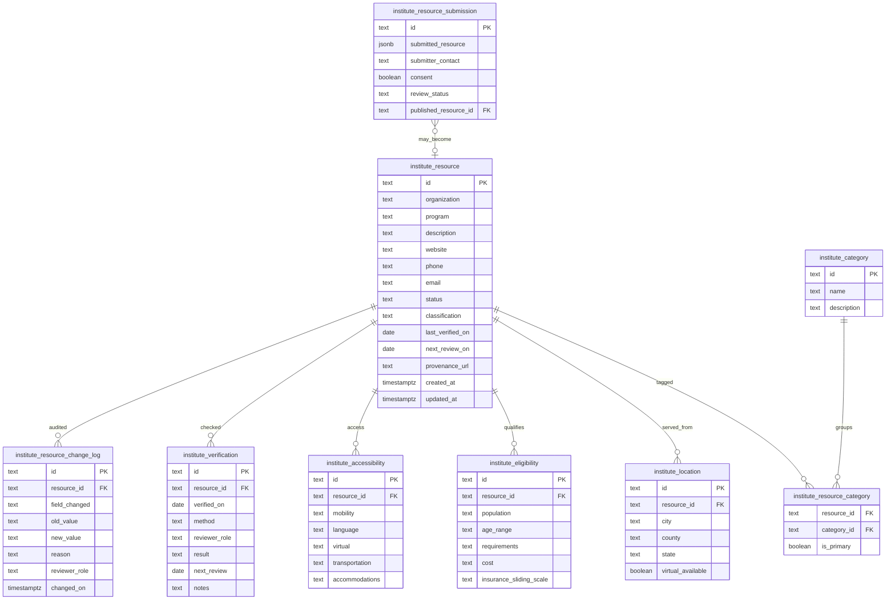

# Institute ERD

Weeks 1–2 data design. Tables live in `lib/flagship/institute-schema.sql`. Prefix `institute_` keeps this store apart from genealogy and Press.

## Relationship rules

- `resource_id` is the stable key. Organization name is not a key.
- Categories are a many-to-many. One row may be primary.
- Location, eligibility, and accessibility are 1:N so a program can carry more than one service area later. The MVP seed uses one row each.
- Verification is append-only. The resource’s `last_verified_on` / `next_review_on` are denormalized for directory queries.
- Submissions do not become resources until a human publishes them. `submitter_contact` is restricted.

## What this ERD does not include

- Genealogy people, sources, or research logs
- Press events or contacts
- Marketing lists
